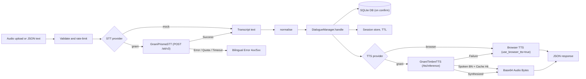

# Architecture

Demo. Do not enter real patient data.

## Turn pipeline

Each `POST /api/turn` request runs through these stages in order:

Audio is held in memory during the request and is never written to disk.

## Layers

- `app/speech`:
  - `SpeechToText` and `TextToSpeech` protocols (`base.py`). `confidence` is `float | None` because Gnani STT does not return confidence scores.
  - `mock.py`: `MockSTT` (extracts text or echo) and `BrowserTTS` (flags `use_browser_tts=True`).
  - `gnani.py`:
    - `GnaniPrismaSTT`: connects to `POST https://api.vachana.ai/stt/v3`. Pre-validates audio format (rejects WebM) and checks duration (rejects > 30s) before making outbound calls. Serialised via concurrency semaphore with exponential backoff on 429 and 5xx. Logs strictly sanitize keys, audio, and transcripts.
    - `GnaniTimbreTTS`: connects to `POST https://api.vachana.ai/api/v1/tts/inference`. Converts bare numbers to spoken Bengali words, hashes request parameters with SHA-256 for local disk caching in `.cache/tts`, and falls back safely to browser TTS if the upstream service fails.
  - `spoken_bn.py`: `number_to_spoken_bn` converts ASCII and Bengali digits (0-100, years, ordinals, currency) to spoken Bengali words so Timbre pronounces them naturally.
  - `providers.py`: factory functions `get_stt` and `get_tts` instantiating adapters based on runtime configuration.
- `app/nlu`: pure functions. `normalise`, `parse_number`, `parse_date`, `extract`.
- `app/dialogue/manager.py`: pure state machine. States are `IDLE`, `AWAITING_CONFIRMATION`, `AWAITING_FIELD`. It does no I/O.
- `app/turn.py`: the HTTP route. It holds the limits, provider selection, persistence, timings, and error mappings.
- `config/`: `incentives.yaml`, `lexicon.yaml`, `i18n.yaml`. All user-facing strings come from `i18n.yaml`.
