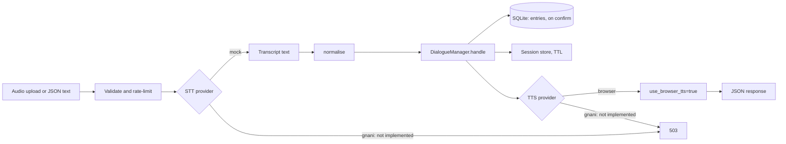

# Architecture

Demo. Do not enter real patient data.

## Turn pipeline

Each `POST /api/turn` request runs through these stages in order:

Audio is held in memory during the request and is never written to disk.

## Layers

- `app/speech`: `SpeechToText` and `TextToSpeech` protocols. `mock.py` and `BrowserTTS` run with no keys. `gnani.py` holds all Gnani calls and is a stub.
- `app/nlu`: pure functions. `normalise`, `parse_number`, `parse_date`, `extract`.
- `app/dialogue/manager.py`: pure state machine. States are `IDLE`, `AWAITING_CONFIRMATION`, `AWAITING_FIELD`. It does no I/O.
- `app/turn.py`: the HTTP route. It holds the limits, provider selection, persistence, and timings.
- `config/`: `incentives.yaml`, `lexicon.yaml`, `i18n.yaml`. All user-facing strings come from `i18n.yaml`.
