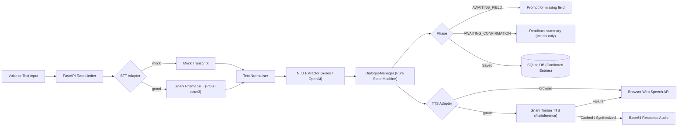

# DidiNotes (ASHA Diary)

Demo. Do not enter real patient data.

## What It Is

**DidiNotes** (internally called "ASHA Diary") is a voice-first work diary for Accredited Social Health Activist (ASHA) community health workers in West Bengal, India.

An ASHA worker verbally speaks her daily activities in colloquial Bengali or Benglish (Bengali mixed with English), such as:
> *"aaj Rina-r ANC visit korlam, 2 jon baccha-r teeka dilam"*

The application:
1. Transcribes audio input using a Speech-to-Text adapter (Mock STT for local development; Gnani Prisma in production).
2. Extracts structured work records using an NLU extractor (task type, event date, count, beneficiary reference).
3. Holds an interactive voice/text confirmation dialogue (reading back recognized records, asking single follow-up questions for missing fields, handling corrections, resolving date traps such as *kal* and *porshu*).
4. Persists confirmed records to an SQLite database.
5. Generates official register-ready lines and monthly incentive claim sheets with CSV export and printable summaries.
6. **Strictly refuses clinical advice queries.** DidiNotes is a record-keeping diary, never a clinical decision or diagnostic tool.

---

## Status

- **Milestones 1 to 4 Complete**:
  - Backend API: FastAPI + Pydantic v2 + SQLAlchemy/SQLite in `apps/api`.
  - Frontend: Next.js (App Router, TypeScript strict, Tailwind CSS) in `apps/web`.
  - NLU Extractor: Pure rules-based extractor with 100% exact match across the 60-item evaluation set; optional OpenAI LLM fallback.
  - Evaluation Suite: 60-item utterance and dialogue evaluation suite (`eval/run_extraction_eval.py`), noise mixing tool (`eval/add_noise.py`), and STT Word Error Rate evaluation tool (`eval/run_stt_eval.py`).
  - Automated Smoke Scripts: Cross-platform end-to-end conversation and persistence smoke scripts (`scripts/smoke.sh`, `scripts/smoke.ps1`).
  - **Gnani Speech Integration**: Gnani Prisma STT and Timbre TTS adapters fully integrated with concurrency semaphore, exponential backoff retries, Bengali spoken numbers converter (`number_to_spoken_bn`), SHA-256 disk caching, and browser TTS fallback.
  - 187 automated backend unit and integration tests passing.

---

## Quick Start

The system runs end-to-end with **no external API keys** out of the box (uses `MockSTT` and browser speech synthesis).

### Windows

#### 1. Backend (FastAPI)
```powershell
cd apps/api
python -m venv .venv
.\.venv\Scripts\activate
pip install -r requirements-dev.txt
pytest -q
ruff check .
uvicorn app.main:app --port 8000
```

#### 2. Frontend (Next.js)
```powershell
cd apps/web
cmd /c npm install
cmd /c npm run typecheck
cmd /c npm run build
cmd /c npm run dev
```
Open [http://localhost:3000](http://localhost:3000) in your browser.

#### 3. Automated Smoke Test (Windows)
```powershell
powershell -ExecutionPolicy Bypass -File scripts/smoke.ps1
```

---

### macOS and Linux

#### 1. Backend (FastAPI)
```bash
cd apps/api
python3 -m venv .venv
source .venv/bin/activate
pip install -r requirements-dev.txt
pytest -q
ruff check .
uvicorn app.main:app --port 8000
```

#### 2. Frontend (Next.js)
```bash
cd apps/web
npm install
npm run typecheck
npm run build
npm run dev
```
Open [http://localhost:3000](http://localhost:3000) in your browser.

#### 3. Automated Smoke Test (macOS / Linux)
```bash
bash scripts/smoke.sh
```

---

## Configuration

Settings are managed via `pydantic-settings` from environment variables or a `.env` file at repository root. Copy `.env.example` to `.env`:

```bash
cp .env.example .env
```

| Variable | Default | Description |
|---|---|---|
| `LLM_PROVIDER` | `rules` | NLU extraction engine (`rules` or `openai`). Defaults to zero-dependency rules. |
| `OPENAI_API_KEY` | *(empty)* | OpenAI API key if `LLM_PROVIDER=openai`. |
| `OPENAI_MODEL` | `gpt-4o-mini` | Model name for OpenAI extractor. Runs with `temperature: 0`. |
| `OPENAI_BASE_URL` | `https://api.openai.com/v1` | Base URL for OpenAI-compatible endpoint. |
| `LLM_TIMEOUT_SECONDS` | `5.0` | Timeout in seconds before falling back to rules extractor. |
| `STT_PROVIDER` | `mock` | Speech-to-Text provider (`mock` or `gnani`). |
| `TTS_PROVIDER` | `browser` | Text-to-Speech provider (`browser` or `gnani`). |
| `STORE_AUDIO` | `false` | Whether to persist uploaded audio files to disk. Currently uncommitted in memory. |
| `GNANI_API_KEY` | *(empty)* | API key for Gnani Prisma STT and Timbre TTS. Required when provider is `gnani`. |
| `GNANI_BASE_URL` | `https://api.vachana.ai` | Base URL for Gnani services. |
| `GNANI_STT_MODEL` | *(empty)* | STT model: empty for Prisma v2.5, or `prisma-v3.0`. |
| `GNANI_STT_LANGUAGES` | `bn-IN` | Language code for STT transcription. |
| `GNANI_STT_FORMAT` | *(empty)* | Transcript format (e.g. `verbatim`, `transcribe`, `codemix`). |
| `GNANI_STT_TOPIC` | *(empty)* | Optional STT context topic. |
| `GNANI_STT_KEYTERMS` | *(empty)* | Optional STT keyterms (JSON array or comma-separated). |
| `GNANI_TTS_MODEL` | `timbre-v3.0` | TTS model (`timbre-v3.0` or `timbre-v2.5`). |
| `GNANI_TTS_VOICE` | `Shivani` | Voice name (e.g. `Shivani`, `Riyaa`, `Kalpana`, `Chetana`, `Devansh`). |
| `GNANI_TTS_LANGUAGE` | `bn-IN` | Language code for TTS synthesis. |
| `GNANI_TTS_SPEED` | `1.0` | Speech rate multiplier (0.85 to 1.15). |
| `GNANI_TTS_CONTAINER` | `mp3` | Audio container format (`mp3` or `wav`). |
| `GNANI_TTS_SAMPLE_RATE` | `24000` | Audio sampling rate in Hz. |
| `GNANI_TTS_SPOKEN_NUMBERS` | `true` | Convert bare digits to spoken Bengali words before synthesis. |
| `GNANI_MAX_CONCURRENCY` | `1` | Maximum outbound concurrent requests to Gnani API. |
| `GNANI_TIMEOUT_S` | `30.0` | Outbound request timeout in seconds. |
| `TTS_CACHE_DIR` | `.cache/tts` | Local directory for SHA-256 hashed TTS audio cache. |
| `TZ` | `Asia/Kolkata` | Application timezone (Indian Standard Time). |
| `DATABASE_URL` | `sqlite:///asha_diary.db` | SQLAlchemy SQLite database connection string. |
| `CONFIG_DIR` | `config/` | Path to YAML configuration directory. |
| `MAX_AUDIO_BYTES` | `2000000` | Maximum uploaded audio payload size (2 MB). |
| `MAX_AUDIO_SECONDS` | `60` | Maximum audio duration in seconds (Gnani STT enforces 30s limit). |
| `RATE_LIMIT_PER_MINUTE` | `30` | In-memory rate limit per client IP for `/api/turn`. |
| `SESSION_TTL_SECONDS` | `900` | Dialogue session time-to-live in memory (15 minutes). |

---

## API Endpoints

All backend routes are prefixed with `/api`.

### Core & Configuration
- `GET /api/health` — Returns system status (`"status": "ok"`) and the mandatory demo banner.
- `GET /api/config/task-types` — Returns the list of 6 health task types and required documentation.

### Conversational Turn Pipeline
- `POST /api/turn` — Handles audio or JSON text input. Accepts `{ session_id, text, lang }` or multipart audio. Returns:
  - `transcript`: Transcribed speech or echoed input text.
  - `entries`: List of recognized draft entries.
  - `response_text`: Bengali or English dialogue response for the ASHA worker.
  - `response_audio`: Base64-encoded audio if server TTS is active, else `null` (uses browser TTS).
  - `ui_hint`: UI action tag (`ask_field`, `confirm`, `saved`, `repeat`, `type_input`, `refusal`).
  - `timings_ms`: Latency breakdown (`stt`, `nlu`, `llm`, `tts`).
  - `providers`: Active provider names (`stt`, `tts`, `nlu`).
  - `tts_fallback`: Boolean indicating whether server TTS fell back to browser TTS.

### Work Diary & Entries
- `GET /api/entries?date=YYYY-MM-DD` — Lists diary entries for a specific date (defaults to today in IST).
- `PATCH /api/entries/{id}` — Updates editable fields (`task_type`, `count`, `event_date`, `beneficiary_ref`, `notes`, `documents`). Re-validates constraints.
- `POST /api/entries/{id}/confirm` — Explicitly marks a draft entry as confirmed.
- `DELETE /api/entries/{id}` — Deletes an entry.

### Claims & Register Export
- `GET /api/claims/{yyyy-mm}` — Aggregates confirmed entries for the month, calculates sample incentive totals, flags missing documents, and generates register lines.
- `GET /api/claims/{yyyy-mm}/export` — Exports the monthly claim summary as a UTF-8 CSV with BOM for Excel compatibility.
- `GET /api/claims/{yyyy-mm}/print` — Generates a printable HTML report of the monthly register with demo disclaimer.

---

## How It Works



1. **Privacy-Preserving Beneficiary Reference**: Beneficiary names are reduced to initials (e.g. "Rina" becomes "R", "Mina Begum" becomes "MB") or short IDs (e.g. "ID 47"). Full patient names are never stored or logged.
2. **Ambiguous Date Handling**: Bengali terms *kal* and *porshu* refer to either past or future days depending on context. The system defaults to the past (yesterday / day before yesterday) and sets `date_ambiguous: true`, prompting the ASHA for clarification. Completed work is never silently recorded in the future.
3. **Dialogue State Machine**: Pure state machine with states `IDLE`, `AWAITING_CONFIRMATION`, and `AWAITING_FIELD`. Handles readback, corrections ("na, count 3"), repeat prompts on unintelligible speech, and fallback to typed input.
4. **Strict Clinical Refusal**: Medical advice queries (e.g., *"ki dose dibo"*, *"jor hole ki korbo"*) trigger an immediate standard refusal directing the worker to consult an ANM/MO-IC.
5. **Speech Safety & Privacy**: Outbound Gnani logs record only `request_id`, `model`, `latency_ms`, and `status`. Audio bytes, transcripts, and API keys are never logged.

---

## Plugging in Gnani

The Gnani Prisma (STT) and Timbre (TTS) adapters are implemented in `apps/api/app/speech/gnani.py` using `httpx`.

### 1. Enable Gnani in `.env`
Add your API credentials to `.env`:
```bash
STT_PROVIDER=gnani
TTS_PROVIDER=gnani
GNANI_API_KEY=your_actual_gnani_api_key
GNANI_BASE_URL=https://api.vachana.ai
GNANI_STT_MODEL=prisma-v3.0
GNANI_TTS_MODEL=timbre-v3.0
GNANI_TTS_VOICE=Shivani
```

### 2. Verify Live Connectivity
Run the opt-in live check script to perform 1 live TTS synthesis and 1 live STT transcription round-trip:
```powershell
python scripts/gnani_live_check.py --yes
```
*(The `--yes` flag is mandatory to prevent accidental API credit consumption.)*

### 3. Generate Voice Comparison Samples
Generate sample audio across 6 different Timbre voices to listen and evaluate the best voice for rural Bengal:
```powershell
python scripts/tts_voice_samples.py --yes
```
Output audio files are saved to `eval/audio/voices/{voice}.mp3` (ignored by Git).

### 4. Adapter Features
- **Bengali Spoken Numbers**: Preprocessing via `number_to_spoken_bn()` converts bare digits (০-৯ and 0-9) to spoken Bengali words (e.g., `2026` -> `"দুই হাজার ছাব্বিশ"`, `₹200` -> `"দুইশত টাকা"`, `২৯ অক্টোবর` -> `"ঊনত্রিশ অক্টোবর"`) so Timbre pronounces them naturally.
- **Disk Caching**: Synthesized audio is cached locally in `.cache/tts/` using SHA-256 signatures, avoiding redundant HTTP requests for common prompts and confirmations.
- **Pre-send Audio Validation**: STT rejects WebM audio (HTTP 415) and audio exceeding 30 seconds (HTTP 413) before sending HTTP requests, saving bandwidth and API credits.
- **Fail-Safe Operation**: If Gnani TTS fails or is unreachable, the system automatically falls back to browser TTS with `tts_fallback: true` without failing the user's turn. If STT fails, a clear bilingual error is returned with a prompt to type.

---

## Manual Browser Test Script (10 Steps)

> [!WARNING]
> **Verification Status**:
> Browser microphone capture, audio recording/playback, and live browser speech synthesis have been tested via unit tests, TypeScript compilation, and production builds, but **remain unverified until you execute this manual 10-step script in your browser**.

1. **Microphone Permission**: Open [http://localhost:3000](http://localhost:3000) in Chrome/Edge. Press the large Talk button; the browser should prompt for microphone permission. Denying permission displays the bilingual notice *"Microphone access was denied. Please allow microphone access or type below."* Grant permission.
2. **Hold-to-Talk Recording**: Press and hold the Talk button, speak *"aaj Rina ANC visit korlam"*, and release. The button pulses red with an active timer. On release, the client resamples and encodes 16 kHz Mono 16-bit PCM WAV (`recording.wav`) and uploads to `/api/turn`.
3. **Long Recording Auto-Stop**: Press and hold the Talk button without speaking for 29 seconds. Verify the timer badge reaches `29s / 29s` and automatically stops and sends the audio, preventing the 30-second Gnani limit rejection.
4. **Typed-Input Fallback**: If speech is unavailable or fails, type *"aaj Rina ANC visit korlam"* into the text field and click **Send**. The assistant asks for missing count: *"কত জনের ANC ভিজিট করেছেন?"* (How many people's ANC visit did you do?).
5. **Interactive Confirmation (Readback)**: Type or speak *"2 jon"*. The system enters the confirmation state and displays the readback card with **YES (হ্যাঁ)**, **NO (না)**, and **EDIT (সম্পাদনা)** buttons.
6. **Voice Correction**: Click or say **EDIT (সম্পাদনা)** or say *"na, 3 jon"*. The system updates the draft count to 3 without creating duplicate entries. Click **YES (হ্যাঁ)** to confirm.
7. **Diary Screen Inspection & Edit**: Navigate to the **Diary (ডায়েরি)** tab. The confirmed entry appears under today's work. Click **Edit**, adjust the count or beneficiary reference, and save.
8. **Monthly Claim Sheet**: Navigate to the **Claim (দাবি)** tab for the current month. The confirmed entry appears aggregated in the activity summary and register lines.
9. **CSV Export**: Click **Download CSV**. Verify the downloaded CSV file contains the official headers and confirmed claim row.
10. **Printable Summary**: Click **Print page**. Verify the print preview formats cleanly, renders the sample banner, and includes register-ready lines.

---

## Testing Status

| Suite | Scope | Result |
|---|---|---|
| `pytest -q` | `apps/api/tests` (190 tests) | **190 passed** |
| `ruff check .` | `apps/api`, `eval/`, `scripts/` | **All checks passed** |
| `check-wav.mjs` | `apps/web/scripts` (WAV 16k PCM & resampler) | **All checks passed** |
| `npm run typecheck` | `apps/web` (TypeScript strict) | **0 errors** |
| `npm run build` | `apps/web` (Next.js 15 production build) | **Compiled successfully**, 4 routes generated |
| `run_extraction_eval.py` | 60 items in `eval/utterances.jsonl` | **100.0% exact match** (60/60) |
| `punctuation_sensitivity` | Sample sentences with bare, '।', and '.' | **0 discrepancies** (100% robust) |
| `smoke.ps1` | End-to-end conversation & persistence | **PASSED** |

---

## Limitations and Not Verified

1. **Browser Microphone & Playback Unverified**: Real browser microphone hardware capture, browser audio playback, and live Gnani round-trip through the browser UI are unverified until the 10-step manual script above is executed.
2. **Real Field Speech Dataset & Accuracy**: No real ASHA speech recordings have been collected or committed. Real-world accuracy under rural field noise (traffic, clinics, rain) cannot be claimed until real recordings are collected per `docs/RECORDING_GUIDE.md`.
3. **Lexicon and Bengali Terminology**: `config/lexicon.yaml` and `config/i18n.yaml` are initial developer drafts and **require native speaker review** with local health workers in West Bengal.
4. **Sample Incentive Amounts**: Amounts in `config/incentives.yaml` are sample data only and marked `verified: false`. The system deliberately displays *"amount not configured"* on monthly claim summaries until verified.
5. **Live Gnani Endpoints in Automated Tests**: Automated backend unit tests strictly mock HTTP calls via `httpx.MockTransport` and `conftest.py` forces mock speech adapters during testing. Live API accuracy and latency depend on Gnani cloud infrastructure.
